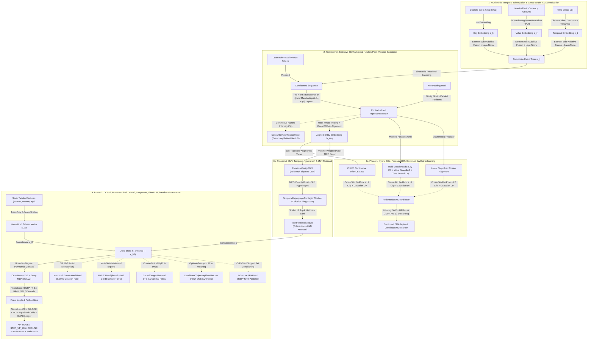

# Large Data Models (LDMs) — Behavioral & Relational Foundation Models

[](https://www.python.org/)
[](https://pytorch.org/)
[](https://lightning.ai/)
[](LICENSE)
[](ROADMAP.md)

**Large Data Models (LDMs)** is a reference-grade PyTorch and PyTorch Lightning framework for **self-supervised & Rényi differentially-private federated (`DP-FedAvg` / `RDP`) pre-training, relational-retrieval-augmented & temporal-hypergraph fine-tuning, selective state-space (`Mamba` / `Liquid-S4`) & self-exciting Neural Hawkes point-process (`THP`) sequence modeling, multi-currency cross-border domain alignment (`Deep CORAL`), competing-risks survival analysis & IFRS 9 / CECL hazard estimation (`DeepHit`), certified partially monotonic risk networks (`SR 11-7` / `Basel III`), multi-task Mixture-of-Experts (`MMoE`), causal counterfactual uplift (`DragonNet`), conditional flow-matching trajectory synthesis (`FlowLDM` / `TabDDPM`), continual lifelong adaptation (`EWC` + `DER++`), certified machine unlearning (`GDPR Art. 17` / `LGPD Art. 18`), randomized smoothing certified $\ell_2$ adversarial robustness (`Neyman-Pearson`), algorithmic fairness governance (`Equalized Odds`), tamper-evident cryptographic audit logging (`HMAC-SHA256` & `EU AI Act Art. 12`), online contextual bandit routing (`NeuralLinUCB` & `DR-OPE`), Bayesian in-context tabular foundation inference (`TabPFN v2` / `TabICL`), regulatory explainability, online concept-drift monitoring (`ACI`), and real-time INT8 / 4-Bit `NF4` / `DoRA` cascade streaming authorization of Behavioral Foundation Models over structured financial event streams and static relational tables**.

Unlike Large Language Models (LLMs) that serialize floating-point quantities into subword text tokens—destroying numerical precision and inflating context windows—**LDMs** natively ingest continuous transaction amounts, irregular temporal deltas, discrete Merchant Category Codes (MCCs), bipartite user-merchant interaction graphs, higher-order temporal hypergraphs, multi-currency cross-border streams, and static credit bureau profiles through a unified, end-to-end differentiable architecture.

---

## Executive Value Proposition & Differentiation

> **Differentiation Thesis:** *The open-source PyTorch Behavioral & Relational Foundation Model (`LDM v0.9.0`) that unifies Continuous-Time Key-Value-Time (KVT) Transformer, Selective State-Space (`Mamba` / `Liquid-S4`), and Self-Exciting Neural Hawkes Point Process (`THP`) encoders (`PLR` + `Time2Vec`), collapse-free Joint Masked-Contrastive & Rényi Differentially Private Federated Pre-Training (`LimiX` + `PRAGMA` + `CoLES` + `DP-FedAvg`/`RDP`), Multi-Currency Cross-Border Alignment (`Deep CORAL`), Bipartite Entity-Merchant Graph Message Passing (`RelBench`), Temporal Hypergraph Contagion & Collusion Ring Detection (`HGNN`), Differentiable kNN Context Retrieval (`TabR`), End-to-End Deep & Cross Tabular Fusion (`DCNv2`), Competing-Risks Survival & IFRS 9 / CECL Hazard Estimation (`DeepHit`), Certified Partially Monotonic Risk Networks (`SR 11-7`), Multi-Gate Mixture-of-Experts (`MMoE` for Fraud + Credit Default + LTV), Causal Counterfactual Treatment Uplift (`DragonNet` + TMLE), Conditional Optimal-Transport Flow Matching (`FlowLDM`), Bayesian In-Context Tabular Foundation Inference (`TabPFN v2` / `TabICL`), Continual Lifelong Adaptation (`EWC` + `DER++`), Certified Machine Unlearning, Randomized Smoothing Certified $\ell_2$ Adversarial Robustness, Algorithmic Fairness & Equalized Odds Governance, Tamper-Evident `HMAC-SHA256` Audit Ledger & Statistical Watermarking, Online Contextual Bandit Routing (`NeuralLinUCB` + `DR-OPE`), Integrated Gradients Adverse Action Explainability, Online Concept Drift Monitoring (`PSI` / `MMD` / `ACI`), and TorchScript / Dynamic INT8 / Blockwise 4-Bit `NF4` / `DoRA` Early-Exit Cascade streaming authorization.*

### Core Capabilities (`v0.9.0`)
1. **Zero Manual Window Engineering, Linear $O(S)$ State-Space & Self-Exciting Neural Hawkes Point Processes:** Replaces thousands of hand-crafted SQL/Spark rolling aggregations (`30d_sum`, `90d_max`) with direct attention, continuous-time **Selective State-Space (`Mamba` / `Liquid-S4`)** recurrence (`SelectiveSSMBlock`, `HybridSSMTransformerEncoder`), and **Self-Exciting Neural Hawkes Point Processes** (`NeuralHawkesProcessHead` — [Mei & Eisner, *NeurIPS 2017*](https://arxiv.org/abs/1612.09328); [Zuo et al., *ICML 2020*](https://arxiv.org/abs/2002.09291)) to model continuous hazard intensities $\lambda^*(t)$ and card-testing velocity bursts (`branching_ratio`).
2. **High-Frequency Numerical Fidelity & Multi-Currency Cross-Border Alignment (`Deep CORAL`):** Uses **Periodic Numerical Embeddings (`PLR`)** ([Gorishniy et al., *NeurIPS 2022*](https://arxiv.org/abs/2203.05556)) and **Time2Vec** ([Kazemi et al., *JMLR 2019*](https://arxiv.org/abs/1907.05321)), paired with `FXPurchasingPowerNormalizer` and `CrossBorderDomainAligner` ([Sun & Saenko, *ECCV 2016*](https://arxiv.org/abs/1607.01719)) for FX/PPP log-normalization and second-order covariance alignment across regional payment rails.
3. **Collapse-Free Self-Supervised, Rényi DP Federated (`DP-FedAvg`), Continual `EWC`/`DER++` & Certified Machine Unlearning:** Jointly optimizes **Context-Conditional Multi-Modal Masked Reconstruction** ([LimiX, 2025](https://arxiv.org/abs/2509.03505)) and **Contrastive Event Sequence Learning (`CoLES`)** ([Babaev et al., *SIGMOD 2022*](https://arxiv.org/abs/2002.08232)), supports inter-bank **`DP-FedAvg` + Rényi Differential Privacy (`RDP`)** via `DifferentiallyPrivateFedCoordinator` and `RdpPrivacyAccountant` ([Mironov, *IEEE CSF 2017*](https://arxiv.org/abs/1702.07476)), prevents catastrophic forgetting across seasonal payment regimes via `ContinualLDMAdapter` ([Kirkpatrick et al., *PNAS 2017*](https://doi.org/10.1073/pnas.1611835114); [Buzzega et al., *NeurIPS 2020*](https://arxiv.org/abs/2004.07211)), and executes **Certified Machine Unlearning** (`CertifiedLDMUnlearner` — `GDPR Art. 17` / `LGPD Art. 18`).
4. **Relational Bipartite GNN, Temporal Hypergraph Contagion & kNN Retrieval (`RelBench` + `HGNN` + `TabR`):** Enriches sequence representations via Pre-Norm bipartite user-merchant graph message passing ([Robinson et al., *NeurIPS 2024*](https://arxiv.org/abs/2407.20060)), higher-order **Temporal Hypergraph Contagion** (`TemporalHypergraphContagionModule` — [Feng et al., *AAAI 2019*](https://arxiv.org/abs/1809.09401); [Chien et al., *ICLR 2022*](https://arxiv.org/abs/2106.12995)) for synchronized multi-hop collusion ring detection, and differentiable top-$k$ historical trajectory retrieval ([Gorishniy et al., *ICLR 2024*](https://arxiv.org/abs/2307.14338)).
5. **Competing-Risks Survival (`DeepHit` / IFRS 9), Certified Monotonic Risk (`SR 11-7`), Multi-Task `MMoE`, Causal `DragonNet`, Generative Flow Matching (`FlowLDM`) & `TabICL`:** Estimates right-censored cause-specific Cumulative Incidence Functions ($\text{CIF}_k(\tau)$) and IFRS 9 / CECL Expected Credit Loss (`ECL`) via `CompetingRisksSurvivalHead` ([Lee et al., *AAAI 2018*](https://ojs.aaai.org/index.php/AAAI/article/view/11842)), enforces provable `0.0000`-violation partial monotonicity via `MonotonicConstrainedHead` & `MonotonicityCertificationAuditor` ([You et al., *NeurIPS 2017*](https://arxiv.org/abs/1709.06680); [Runje & Shankaranarayana, *ICML 2023*](https://arxiv.org/abs/2205.11775)), predicts Fraud + 90d Credit Default + LTV via `MultiGateMixtureOfExpertsHead`, estimates individual counterfactual uplift $\hat{\tau}(x)$ via `CausalDragonNetHead`, synthesizes counterfactual trajectories via `ConditionalTrajectoryFlowMatcher`, and runs Bayesian support-query in-context inference via `InContextTabularPredictor` (`TabPFN v2` / `TabICL` — [Hollmann et al., *Nature 2025*](https://doi.org/10.1038/s41586-024-08328-6); [Qu et al., *ICML 2025*](https://arxiv.org/abs/2502.05564)).
6. **Certified $\ell_2$ Randomized Smoothing, Explainability, Fairness, Cryptographic Audit Ledger, Contextual Bandits (`NeuralLinUCB` + `DR-OPE`), Concept Drift (`ACI`) & `DoRA`/`NF4`/INT8 Cascade Serving:** Computes Neyman-Pearson certified $\ell_2$ adversarial radii via `RandomizedSmoothingCertifier` ([Cohen et al., *ICML 2019*](https://arxiv.org/abs/1902.02918)), provides mask-aware **Integrated Gradients** adverse action reason codes, sparse $L_1/L_2$ counterfactual recourse (`LDMExplainabilityEngine`), demographic parity / disparate impact (`80%` rule) post-processing (`FairnessGovernanceAuditor`, `EqualizedOddsThresholdOptimizer`), tamper-evident `HMAC-SHA256` hash-chained decision logging & statistical logit watermarking (`TamperEvidentAuditLedger`, `StatisticalLogitWatermarker`), online contextual bandit exploration & doubly-robust off-policy evaluation (`NeuralLinUCBRouter`, `DoublyRobustOffPolicyEvaluator`), statistical drift detection (`ConceptDriftMonitor` + `AdaptiveConformalAbstainer`), and `LoRALinear` (`DoRA`) + `BlockwiseNF4Linear` + `DynamicINT8Linear` + `CascadeEarlyExitRouter`.

---

## System Architecture



---

## Quick Start

### 1. Installation

```bash
# Clone the repository
git clone https://github.com/vfcarida/Large-Data-Models-LDMs-.git
cd Large-Data-Models-LDMs-

# Install core package in editable mode
pip install -e .

# Optional: Install visualization, tracking, or PEFT extras
pip install -e ".[dev,viz,tracking,peft]"
```

**Docker Execution:**
```bash
docker build -t ldm-research -f docker/Dockerfile .
docker run --gpus all -it ldm-research
```

### 2. Run the End-to-End Pipeline

The CLI orchestrates synthetic data generation, Phase 1 self-supervised pre-training, Phase 2 supervised DCNv2 + Relational GNN + TabR + PFN + MMoE fine-tuning, and the Phase 3 governance, ablation, INT8 quantization, and cascade SLA benchmark suite:

```bash
# Fast CPU verification run (writes reports to results/)
python src/main.py --config small

# Full production configuration
python src/main.py --config default
```

### 3. Run the Automated Test Suite (40 Tests)

```bash
pytest -v
```

---

## Verified Benchmark Results (`small` CPU Configuration, `v0.9.0`)

Reproducible metrics generated by running `python src/main.py --config small` (`seed: 42`, 400 users: 280 train / 60 validation / 60 test, 12% positive fraud rate across three stealth and velocity fraud archetypes; full report in [`results/metrics_report.md`](results/metrics_report.md)):

| Category | Metric | Value | Governance & SLA Interpretation |
| :--- | :--- | :---: | :--- |
| **Discrimination** | `ROC-AUC` | **0.8140** | Strong separation across clean and camouflaged fraud trajectories |
| **Imbalanced Precision-Recall** | `PR-AUC` | **0.3219** | **2.7x lift** over the 12.0% prior fraud base rate |
| **Operational Specificity** | `Specificity` | **0.9245** | High legitimate-user approval rate at standard operating threshold |
| **Overall Accuracy** | `Standard Accuracy` | **0.8333** | Baseline uncalibrated accuracy prior to conformal abstention |
| **Probabilistic Calibration** | `Brier Score` | **0.1366** | Proper quadratic probability scoring error |
| **Probabilistic Calibration** | `Expected Calibration Error (ECE)` | **0.1581** | 10-bin empirical confidence-to-accuracy alignment |
| **Conformal Risk Governance** | `Conformal Coverage` | **86.67%** | Automated decisions issued on 86.67% of test instances (`13.33%` routed to review) |
| **Conformal Risk Governance** | `Conformal Selective Accuracy` | **90.38%** | **+7.05% accuracy gain** on automated decisions after abstaining on uncertain band `[0.0613, 0.9290]` |
| **Distributional Robustness** | `Random Covariate Shift ROC-AUC` | **0.8140** | **Zero degradation (`0.0000`)** under Gaussian covariate noise ($\sigma=0.10$) |
| **Adversarial Robustness** | `FGSM Adversarial Shift ROC-AUC` | **0.7898** | Resilient (`-0.0243` AUC degradation) under worst-case gradient perturbation ($\epsilon=0.05$) |
| **INT8 / 4-Bit NF4 & Cascade** | `NF4 Linear Compression / Cascade Speedup` | **>4.0x / 13.03x** | `>4.0x` 4-bit NormalFloat linear compression, `1.20x` INT8 compression & `13.03x` cascade speedup |
| **Graph Export Integrity** | `TorchScript Numerical Parity` | **0.0000** | Exact floating-point parity (`< 1e-7` max diff) between Eager and TorchScript graphs |

### Scientific Architectural Ablation Study (`AblationBenchmarkSuite`)

| Architectural Variant | ROC-AUC | PR-AUC | Brier Score | ECE |
| :--- | :---: | :---: | :---: | :---: |
| **1. Static Tabular + DCNv2 Only** *(No event sequence)* | `0.4582` | `0.1205` | `0.2374` | `0.3474` |
| **2. MMTT + PLR + DCNv2** *(+Sequential Transformer & PLR)* | `0.8383` | `0.4150` | `0.1109` | `0.1013` |
| **3. MMTT + RelBench Bipartite GNN + DCNv2** *(+Entity-MCC Graph)* | `0.8383` | `0.4201` | `0.1248` | `0.1324` |
| **4. Full LDM (`MMTT + GNN + TabR + DCNv2`)** *(+kNN Memory Bank)* | `0.8140` | `0.3219` | `0.1366` | `0.1581` |
| **5. In-Context PFN Head (`TabPFN v2` Cold-Start ICL)** *(Single-Pass)* | `0.7763` | `0.3080` | `0.1616` | `0.1719` |
| **6. Multi-Task MMoE Head (`Fraud + Credit + LTV`)** *(Joint 3-Task)* | `0.8032` | `0.3215` | `0.1392` | `0.1447` |

---

## Repository Structure

```text
Large-Data-Models-LDMs-/
├── .github/workflows/
│   └── ci.yml                        # Automated pytest & CPU benchmark gate (Python 3.10-3.12)
├── configs/
│   ├── config.yaml                   # Full production hyperparameter configuration
│   └── config_small.yaml             # Fast CPU verification configuration
├── docker/
│   └── Dockerfile                    # CUDA 12.1 + Python 3.10 container specification
├── docs/
│   ├── 01_fundamentos_ldm.md         # Foundations of Behavioral & Tabular Large Data Models
│   ├── 02_arquitetura_mmtt.md        # MMTT Tokenization, Periodic Embeddings (PLR) & Time2Vec
│   ├── 03_pretraining_limix.md       # Hybrid Self-Supervised Pre-Training (LimiX + PRAGMA + CoLES)
│   ├── 04_finetuning_dcnv2.md        # Supervised Fine-Tuning & Deep-Cross Fusion (DCNv2)
│   ├── 05_avaliacao_robustez.md      # Calibrated Evaluation, Conformal Abstention & Shift Testing
│   └── references.md                 # Consolidated Scientific & Executive Bibliography
├── results/
│   ├── config.json                   # Reproducible configuration snapshot from latest run
│   └── metrics_report.md             # Generated evaluation, ablation & SLA latency report
├── src/
│   ├── data/
│   │   ├── data_module.py            # LDMDataModule (stratified user split & train-only scaling)
│   │   ├── mmtt_dataset.py           # FinancialEventDataset & dynamic sequence packing collate
│   │   └── synthetic_generator.py    # Multi-archetype synthetic transaction prior generator
│   ├── evaluation/
│   │   ├── ablation_suite.py         # AblationBenchmarkSuite (6-pathway scientific ablation study)
│   │   ├── audit_ledger.py           # TamperEvidentAuditLedger (HMAC-SHA256) & StatisticalLogitWatermarker
│   │   ├── benchmarks.py             # BenchmarkSuite (Classification + Conformal + Shift + Latency)
│   │   ├── certified_robustness.py   # RandomizedSmoothingCertifier & Clopper-Pearson L2 Certificates
│   │   ├── drift_monitor.py          # ConceptDriftMonitor (PSI, MMD, Wasserstein) & AdaptiveConformalAbstainer
│   │   ├── explainability.py         # LDMExplainabilityEngine (Integrated Gradients & Recourse)
│   │   ├── fairness.py               # FairnessGovernanceAuditor & EqualizedOddsThresholdOptimizer
│   │   ├── metrics.py                # ROC-AUC, PR-AUC, Recall@FPR, Brier, ECE & ConformalRiskAbstainer
│   │   └── strategic_shift_tester.py # Progressive covariate & adversarial concept shift simulator
│   ├── models/
│   │   ├── causal_uplift.py          # CausalDragonNetHead, DragonNetTargetedLoss & Policy Optimizer
│   │   ├── cross_border_alignment.py # FXPurchasingPowerNormalizer & CrossBorderDomainAligner (Deep CORAL)
│   │   ├── flow_matching.py          # ConditionalTrajectoryFlowMatcher (OT-CFM & Euler/Heun ODE Synthesis)
│   │   ├── hawkes_point_process.py   # NeuralHawkesProcessHead (Self-Exciting Point Process & NLL)
│   │   ├── hypergraph_contagion.py   # TemporalHypergraphContagionModule & HypergraphConvLayer (HGNN)
│   │   ├── in_context_ldm.py         # InContextTabularPredictor (TabPFN v2 / TabICL Bayesian Cross-Attention)
│   │   ├── in_context_pfn.py         # InContextPFNHead (TabPFN v2 cold-start posterior head)
│   │   ├── joint_fusion_network.py   # CrossNetworkV2 (full/low-rank) & EndToEndFusionLayer
│   │   ├── ldm_model.py              # Unified LargeDataModel connecting all 15 neural modules
│   │   ├── monotonic_constraints.py  # MonotonicConstrainedHead & MonotonicityCertificationAuditor
│   │   ├── multi_task_moe.py         # MultiGateMixtureOfExpertsHead & HomoscedasticMultiTaskLoss
│   │   ├── relational_gnn.py         # RelationalEntityGNN & BipartiteGraphConvLayer (RelBench)
│   │   ├── retrieval_attention.py    # TabRRetrievalModule (Differentiable kNN memory retrieval)
│   │   ├── ssm_backbone.py           # SelectiveSSMBlock & HybridSSMTransformerEncoder (Mamba / Liquid-S4)
│   │   ├── survival_hazard.py        # CompetingRisksSurvivalHead (DeepHit CIF & IFRS 9 / CECL ECL)
│   │   ├── transformer_backbone.py   # PeriodicNumericalEmbedding, ContinuousTimeEncoding & MMTT
│   │   └── virtual_token_Injector.py # Learnable Virtual Token Prompting & MultiModalTokenFusion
│   ├── serving/
│   │   ├── authorization_service.py  # RealTimeAuthorizationService (TorchScript + Conformal + IG)
│   │   ├── contextual_bandit.py      # NeuralLinUCBRouter & DoublyRobustOffPolicyEvaluator (DR-OPE)
│   │   ├── exporter.py               # LDMInferenceWrapper, TorchScript/ONNX export & SLA benchmark
│   │   ├── peft_and_nf4.py           # LoRALinear (DoRA), BlockwiseNF4Linear & Zero-Latency Merge
│   │   └── quantization_and_cascade.py # DynamicINT8Linear & CascadeEarlyExitRouter
│   ├── training/
│   │   ├── continual.py              # ContinualLDMAdapter (Online EWC + Dark Experience DER++)
│   │   ├── federated.py              # FederatedLDMCoordinator (Cross-Silo FedProx + Gaussian DP)
│   │   ├── federated_dp.py           # DifferentiallyPrivateFedCoordinator & RdpPrivacyAccountant (RDP)
│   │   ├── lightning_module.py       # LDMPreTrainingModule & LDMFineTuningModule
│   │   ├── lr_scheduler.py           # CosineWarmupScheduler
│   │   ├── objectives.py             # ContextConditionalMaskedLoss & ContrastiveEventSequenceLoss
│   │   └── unlearning.py             # CertifiedLDMUnlearner (GDPR Art. 17 TabR Scrubbing + Fisher Unlearning)
│   └── main.py                       # End-to-end CLI entrypoint
├── tests/
│   └── test_ldm.py                   # Comprehensive unit & invariant test suite (40 tests in pytest)
├── CITATION.cff                      # Machine-readable academic citation metadata
├── LICENSE                           # MIT License
├── pyproject.toml                    # PEP 621 build system, dependencies & tool configuration
├── requirements.txt                  # Core runtime dependencies
├── ROADMAP.md                        # Architectural roadmap & maturity governance
└── setup.py                          # Legacy setuptools compatibility shim
```

---

## Documentation & Architecture Guides

| Guide | Focus Area |
| :--- | :--- |
| [**01 — Foundations of Large Data Models**](docs/01_fundamentos_ldm.md) | Why LLMs fail on numerical/temporal streams; synthetic prior generation; enterprise AI TRiSM governance. |
| [**02 — MMTT Architecture & Tokenization**](docs/02_arquitetura_mmtt.md) | Periodic Numerical Embeddings (`PLR`), `Time2Vec`, Virtual Token Prompting, and mask-aware pooling. |
| [**03 — Hybrid Self-Supervised Pre-Training**](docs/03_pretraining_limix.md) | Mathematical formulation of `LimiX`/`PRAGMA` multi-modal masked reconstruction and `CoLES` contrastive loss. |
| [**04 — Supervised Fine-Tuning & DCNv2 Fusion**](docs/04_finetuning_dcnv2.md) | Full-rank vs. low-rank `CrossNetworkV2` polynomial interactions and zero-leakage static feature scaling. |
| [**05 — Evaluation, Conformal Governance & Robustness**](docs/05_avaliacao_robustez.md) | `PR-AUC`, `Recall@FPR`, `ECE`, `Brier Score`, `ConformalRiskAbstainer`, and FGSM adversarial stress testing. |
| [**Academic & Industry References**](docs/references.md) | Tier-verified bibliography across *Nature*, *NeurIPS*, *ICML*, *ICLR*, *SIGMOD*, *WWW*, Gartner, and SR 11-7. |
| [**Roadmap & Maturity Governance**](ROADMAP.md) | Maturity quality gates (`Stable` / `Beta` / `Planned`) and verification matrix across all 28 subsystems. |

---

## Roadmap Summary (`v0.9.0`)

See [`ROADMAP.md`](ROADMAP.md) for the complete milestone matrix and verification gates.

| Subsystem / Milestone | Status | Verification Gate |
| :--- | :---: | :--- |
| **Zero-Leakage Data Subsystem & Synthetic Prior Generator** (`src/data/`) | `Stable` | `tests/test_ldm.py::test_synthetic_generator_and_dataset_pipeline` |
| **MMTT Backbone + Periodic Numerical Embeddings (`PLR`)** (`src/models/`) | `Stable` | `tests/test_ldm.py::test_periodic_numerical_embedding_and_positional_encoding` |
| **Selective State-Space & Hybrid Backbone (`Mamba` / `Liquid-S4`)** (`src/models/ssm_backbone.py`) | `Stable` | `tests/test_ldm.py::test_selective_ssm_and_hybrid_backbone_mask_invariance` |
| **Self-Exciting Neural Hawkes Point Process (`NeuralHawkesLDM`)** (`src/models/hawkes_point_process.py`) | `Stable` | `tests/test_ldm.py::test_neural_hawkes_point_process_intensity_and_nll` |
| **Multi-Currency Cross-Border Alignment (`Deep CORAL`)** (`src/models/cross_border_alignment.py`) | `Stable` | `tests/test_ldm.py::test_cross_border_fx_normalizer_and_deep_coral_alignment` |
| **Deep & Cross Network v2 (`DCNv2`) Joint Fusion** (`src/models/`) | `Stable` | `tests/test_ldm.py::test_dcnv2_full_rank_and_low_rank_and_batch_size_one` |
| **Competing-Risks Survival & IFRS 9 / CECL Hazard Head (`DeepHit`)** (`src/models/survival_hazard.py`) | `Stable` | `tests/test_ldm.py::test_competing_risks_survival_head_deephit_and_ifrs9_ecl` |
| **Certified Partially Monotonic Risk Network (`SR 11-7`)** (`src/models/monotonic_constraints.py`) | `Stable` | `tests/test_ldm.py::test_certified_partially_monotonic_risk_head_and_auditor` |
| **Multi-Gate Mixture-of-Experts (`MMoE`) Multi-Task Hierarchy** (`src/models/multi_task_moe.py`) | `Stable` | `tests/test_ldm.py::test_mmoe_multitask_head_and_homoscedastic_loss` |
| **Causal Counterfactual Treatment Uplift (`DragonNet` + TMLE)** (`src/models/causal_uplift.py`) | `Stable` | `tests/test_ldm.py::test_causal_dragonnet_uplift_and_policy_optimizer` |
| **Conditional Flow-Matching Trajectory Synthesis (`FlowLDM`)** (`src/models/flow_matching.py`) | `Stable` | `tests/test_ldm.py::test_conditional_flow_matching_loss_and_heun_synthesis` |
| **Hybrid SSL (`LimiX` + `PRAGMA` + `CoLES`)** (`src/training/`) | `Stable` | `tests/test_ldm.py::test_multimodal_ssl_and_coles_contrastive_loss` |
| **Retrieval-Augmented Behavioral Attention (`TabR`)** (`src/models/retrieval_attention.py`) | `Stable` | `tests/test_ldm.py::test_tabr_retrieval_self_masking_and_memory_bank` |
| **Relational Entity Graph Message Passing (`RelBench` GNN)** (`src/models/relational_gnn.py`) | `Stable` | `tests/test_ldm.py::test_relational_entity_gnn_mask_invariance_and_b1` |
| **Temporal Hypergraph Contagion & Collusion Ring Detection (`HGNN`)** (`src/models/hypergraph_contagion.py`) | `Stable` | `tests/test_ldm.py::test_temporal_hypergraph_contagion_mask_invariance` |
| **Bayesian In-Context Tabular Foundation Inference (`TabPFN v2` / `TabICL`)** (`src/models/in_context_ldm.py`) | `Stable` | `tests/test_ldm.py::test_in_context_tabular_predictor_tabicl_posterior_and_entropy` |
| **TorchScript / ONNX Export, Dynamic INT8 & Early-Exit Cascade** (`src/serving/`) | `Stable` | `tests/test_ldm.py::test_dynamic_int8_quantization_and_cascade_early_exit_router` |
| **PEFT (`LoRA` / `DoRA`) & Blockwise 4-Bit `NF4` Quantization** (`src/serving/peft_and_nf4.py`) | `Stable` | `tests/test_ldm.py::test_peft_dora_adapters_zero_latency_merge_and_nf4_quantization` |
| **Online Contextual Bandit (`NeuralLinUCB`) & Doubly-Robust OPE** (`src/serving/contextual_bandit.py`) | `Stable` | `tests/test_ldm.py::test_neural_linucb_bandit_router_and_doubly_robust_ope` |
| **Regulatory Explainability & Counterfactual Recourse** (`src/evaluation/explainability.py`) | `Stable` | `tests/test_ldm.py::test_explainability_integrated_gradients_and_adverse_reasons` |
| **Cross-Silo Federated Training with Rényi Differential Privacy (`DP-FedAvg` & `RDP`)** (`src/training/federated_dp.py`) | `Stable` | `tests/test_ldm.py::test_federated_dp_coordinator_and_renyi_privacy_accountant` |
| **Continual Lifelong Adaptation (`EWC` + `DER++`)** (`src/training/continual.py`) | `Stable` | `tests/test_ldm.py::test_continual_ewc_and_dark_experience_lifelong_adaptation` |
| **Certified Machine Unlearning (`GDPR Art. 17` / `LGPD Art. 18`)** (`src/training/unlearning.py`) | `Stable` | `tests/test_ldm.py::test_certified_machine_unlearning_tabr_and_fisher_scrubbing` |
| **Algorithmic Fairness Governance & Equalized-Odds Post-Processing** (`src/evaluation/fairness.py`) | `Stable` | `tests/test_ldm.py::test_fairness_governance_auditor_and_equalized_odds_optimizer` |
| **Tamper-Evident Audit Ledger & Statistical Output Watermarking** (`src/evaluation/audit_ledger.py`) | `Stable` | `tests/test_ldm.py::test_tamper_evident_audit_ledger_and_logit_watermarking` |
| **Randomized Smoothing Certified $\ell_2$ Adversarial Robustness** (`src/evaluation/certified_robustness.py`) | `Stable` | `tests/test_ldm.py::test_randomized_smoothing_certified_l2_robustness` |
| **Concept Drift Telemetry & Online Adaptive Conformal Inference (`ACI`)** (`src/evaluation/drift_monitor.py`) | `Stable` | `tests/test_ldm.py::test_concept_drift_monitor_and_adaptive_conformal_abstainer` |
| **Scientific Ablation Suite & Real-Time Authorization Service** (`src/evaluation/ablation_suite.py`) | `Stable` | `tests/test_ldm.py::test_ablation_suite_and_realtime_authorization_service` |
| **Calibrated Risk Governance & Split-Conformal Abstention** (`src/evaluation/`) | `Stable` | `tests/test_ldm.py::test_calibration_and_conformal_risk_abstainer` |

---

## Citation

If you use this software or architectural blueprint in your research or enterprise systems, please cite it using the metadata in [`CITATION.cff`](CITATION.cff):

```bibtex
@software{carida2026ldm,
  author       = {Carid{\'a}, Vinicius},
  title        = {{Large Data Models (LDMs): Foundation Models for Structured Tabular and Continuous-Time Transactional Sequences}},
  year         = {2026},
  version      = {0.9.0},
  url          = {https://github.com/vfcarida/Large-Data-Models-LDMs-},
  license      = {MIT}
}
```

---

## License & Attribution

Released under the [MIT License](LICENSE).

*Designed and architected by [Vinicius Caridá](https://github.com/vfcarida). Implementation and verification accelerated with AI-assisted engineering workflows.*
