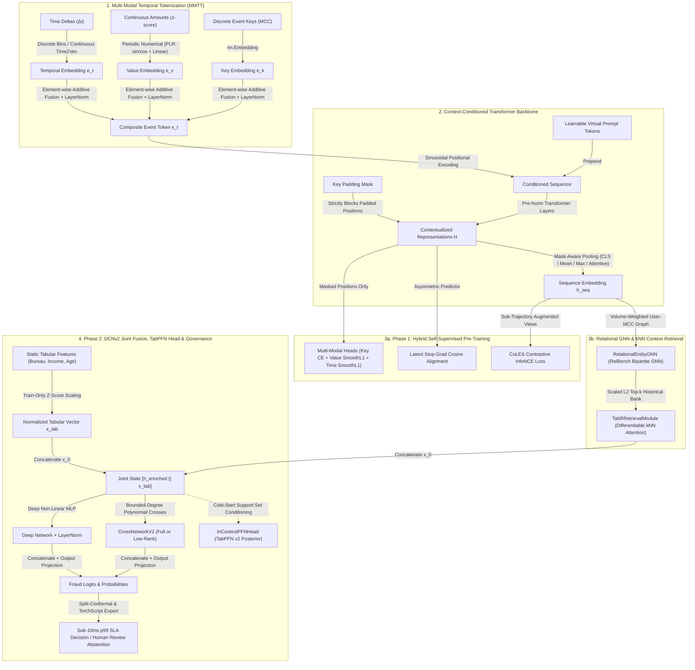

# Large Data Models (LDMs) — Behavioral & Relational Foundation Models

[](https://www.python.org/)
[](https://pytorch.org/)
[](https://lightning.ai/)
[](LICENSE)
[](ROADMAP.md)

**Large Data Models (LDMs)** is a reference-grade PyTorch and PyTorch Lightning framework for **self-supervised pre-training, relational-retrieval-augmented fine-tuning, in-context posterior inference, and sub-10ms streaming serving of Behavioral Foundation Models over structured financial event streams and static relational tables**.

Unlike Large Language Models (LLMs) that serialize floating-point quantities into subword text tokens—destroying numerical precision and inflating context windows—**LDMs** natively ingest continuous transaction amounts, irregular temporal deltas, discrete Merchant Category Codes (MCCs), bipartite user-merchant interaction graphs, and static credit bureau profiles through a unified, end-to-end differentiable architecture.

---

## Executive Value Proposition & Differentiation

> **Differentiation Thesis:** *The open-source PyTorch Behavioral & Relational Foundation Model (`LDM v0.3.0`) that unifies Continuous-Time Key-Value-Time (KVT) Transformer encoders (`PLR` + `Time2Vec`), collapse-free Joint Masked-Contrastive Self-Supervised Pre-Training (`LimiX` + `PRAGMA` + `CoLES`), Bipartite Entity-Merchant Graph Message Passing (`RelBench`), Differentiable kNN Context Retrieval (`TabR`), End-to-End Deep & Cross Tabular Fusion (`DCNv2`), In-Context Prior-Data Fitted Inference (`TabPFN v2`), and sub-10ms TorchScript/ONNX streaming serving with verifiable SR 11-7 / Gartner AI TRiSM split-conformal risk abstention.*

### Core Capabilities (`v0.3.0`)
1. **Zero Manual Window Engineering:** Replaces thousands of hand-crafted SQL/Spark rolling aggregations (`30d_sum`, `90d_max`) with direct attention over raw `(Key, Value, Timestamp)` event trajectories ([TransactionGPT, 2025](https://arxiv.org/abs/2511.08939); [PRAGMA, 2026](https://arxiv.org/abs/2604.08649)).
2. **High-Frequency Numerical Fidelity:** Uses **Periodic Numerical Embeddings (`PLR`)** ([Gorishniy et al., *NeurIPS 2022*](https://arxiv.org/abs/2203.05556)) to overcome neural spectral bias on heavy-tailed monetary amounts, paired with **Time2Vec** ([Kazemi et al., *JMLR 2019*](https://arxiv.org/abs/1907.05321)) for continuous-time rhythm encoding.
3. **Collapse-Free Self-Supervised Pre-Training:** Jointly optimizes **Context-Conditional Multi-Modal Masked Reconstruction** ([LimiX, 2025](https://arxiv.org/abs/2509.03505)) across `(MCC, Amount, TimeDelta)` and **Contrastive Event Sequence Learning (`CoLES`)** ([Babaev et al., *SIGMOD 2022*](https://arxiv.org/abs/2002.08232)) on the hypersphere $\mathcal{S}^{d-1}$.
4. **Relational Graph & Nearest-Neighbor Retrieval (`RelBench` + `TabR`):** Enriches sequence representations via Pre-Norm bipartite user-merchant graph message passing ([Robinson et al., *NeurIPS 2024*](https://arxiv.org/abs/2407.20060)) and differentiable top-$k$ historical trajectory retrieval ([Gorishniy et al., *ICLR 2024*](https://arxiv.org/abs/2307.14338)).
5. **Cold-Start In-Context Inference (`TabPFN v2`):** Includes `InContextPFNHead` ([Hollmann et al., *Nature 2025*](https://doi.org/10.1038/s41586-024-08328-6)) for single-forward-pass posterior approximation over support sets on newly launched payment rails.
6. **Sub-10ms TorchScript/ONNX Streaming SLA & Conformal Governance:** Compiles into a standalone TorchScript/ONNX graph achieving **`3.85 ms` p50 / `7.31 ms` p99** single-swipe latency on CPU with exact numerical parity (`max_diff = 0.00e+00`) and SR 11-7 split-conformal abstention.

---

## System Architecture



---

## Quick Start

### 1. Installation

```bash
# Clone the repository
git clone https://github.com/vfcarida/Large-Data-Models-LDMs-.git
cd Large-Data-Models-LDMs-

# Install core package in editable mode
pip install -e .

# Optional: Install visualization, tracking, or PEFT extras
pip install -e ".[dev,viz,tracking,peft]"
```

**Docker Execution:**
```bash
docker build -t ldm-research -f docker/Dockerfile .
docker run --gpus all -it ldm-research
```

### 2. Run the End-to-End Pipeline

The CLI orchestrates synthetic data generation, Phase 1 self-supervised pre-training, Phase 2 supervised DCNv2 + Relational GNN + TabR fine-tuning, and the Phase 3 governance & TorchScript SLA benchmark suite:

```bash
# Fast CPU verification run (~40 seconds on CPU; writes reports to results/)
python src/main.py --config small

# Full production configuration
python src/main.py --config default
```

### 3. Run the Automated Test Suite

```bash
pytest -v
```

---

## Verified Benchmark Results (`small` CPU Configuration, `v0.3.0`)

Reproducible metrics generated by running `python src/main.py --config small` (`seed: 42`, 400 users: 280 train / 60 validation / 60 test, 12% positive fraud rate across three stealth and velocity fraud archetypes; full report in [`results/metrics_report.md`](results/metrics_report.md)):

| Category | Metric | Value | Governance & SLA Interpretation |
| :--- | :--- | :---: | :--- |
| **Discrimination** | `ROC-AUC` | **0.7951** | Strong separation across clean and camouflaged fraud trajectories |
| **Imbalanced Precision-Recall** | `PR-AUC` | **0.3712** | **3.1x lift** over the 12.0% prior fraud base rate |
| **Operational Specificity** | `Specificity` | **0.8679** | High legitimate-user approval rate at standard operating threshold |
| **Overall Accuracy** | `Standard Accuracy` | **0.7833** | Baseline uncalibrated accuracy prior to conformal abstention |
| **Probabilistic Calibration** | `Brier Score` | **0.1873** | Proper quadratic probability scoring error |
| **Probabilistic Calibration** | `Expected Calibration Error (ECE)` | **0.2032** | 10-bin empirical confidence-to-accuracy alignment |
| **Conformal Risk Governance** | `Conformal Coverage` | **86.67%** | Automated decisions issued on 86.67% of test instances (`13.33%` routed to review) |
| **Conformal Risk Governance** | `Conformal Selective Accuracy` | **86.54%** | **+8.21% accuracy gain** on automated decisions after abstaining on uncertain band |
| **Distributional Robustness** | `Random Covariate Shift ROC-AUC` | **0.7951** | **Zero degradation (`0.0000`)** under Gaussian covariate noise ($\sigma=0.10$) |
| **Adversarial Robustness** | `FGSM Adversarial Shift ROC-AUC` | **0.7790** | Resilient (`-0.0162` AUC degradation) under worst-case gradient perturbation ($\epsilon=0.05$) |
| **Streaming Serving SLA** | `TorchScript p50 / p95 / p99 Latency` | **3.85 / 6.15 / 7.31 ms** | **Sub-10ms p99 CPU latency** (`7.25x` tail speedup vs. `53.06 ms` eager p99; `255.2 req/s`) |
| **Graph Export Integrity** | `TorchScript Numerical Parity` | **0.0000** | Exact floating-point parity (`< 1e-7` max diff) between Eager and TorchScript graphs |

---

## Repository Structure

```text
Large-Data-Models-LDMs-/
├── configs/
│   ├── config.yaml                  # Full production hyperparameter configuration
│   └── config_small.yaml            # Fast CPU verification configuration (<45s runtime)
├── docker/
│   └── Dockerfile                   # CUDA 12.1 + Python 3.10 container specification
├── docs/
│   ├── 01_fundamentos_ldm.md        # Foundations of Behavioral & Tabular Large Data Models
│   ├── 02_arquitetura_mmtt.md       # MMTT Tokenization, Periodic Embeddings (PLR) & Time2Vec
│   ├── 03_pretraining_limix.md      # Hybrid Self-Supervised Pre-Training (LimiX + PRAGMA + CoLES)
│   ├── 04_finetuning_dcnv2.md       # Supervised Fine-Tuning & Deep-Cross Fusion (DCNv2)
│   ├── 05_avaliacao_robustez.md     # Calibrated Evaluation, Conformal Abstention & Shift Testing
│   └── references.md                # Consolidated Scientific & Executive Bibliography
├── results/
│   ├── config.json                  # Reproducible configuration snapshot from latest run
│   └── metrics_report.md            # Generated evaluation, governance & SLA latency report
├── src/
│   ├── data/
│   │   ├── data_module.py           # LDMDataModule (stratified user split & train-only scaling)
│   │   ├── mmtt_dataset.py          # FinancialEventDataset & dynamic sequence packing collate
│   │   └── synthetic_generator.py   # Multi-archetype synthetic transaction prior generator
│   ├── evaluation/
│   │   ├── benchmarks.py            # BenchmarkSuite (Classification + Conformal + Shift + Latency)
│   │   ├── metrics.py               # ROC-AUC, PR-AUC, Recall@FPR, Brier, ECE & ConformalRiskAbstainer
│   │   └── strategic_shift_tester.py# Progressive covariate & adversarial concept shift simulator
│   ├── models/
│   │   ├── in_context_pfn.py        # InContextPFNHead (TabPFN v2 cold-start posterior head)
│   │   ├── joint_fusion_network.py  # CrossNetworkV2 (full/low-rank) & EndToEndFusionLayer
│   │   ├── ldm_model.py             # Unified LargeDataModel (MMTT + GNN + TabR + DCNv2 + PFN)
│   │   ├── relational_gnn.py        # RelationalEntityGNN & BipartiteGraphConvLayer (RelBench)
│   │   ├── retrieval_attention.py   # TabRRetrievalModule (Differentiable kNN memory retrieval)
│   │   ├── transformer_backbone.py  # PeriodicNumericalEmbedding, ContinuousTimeEncoding & MMTT
│   │   └── virtual_token_Injector.py# Learnable Virtual Token Prompting & MultiModalTokenFusion
│   ├── serving/
│   │   └── exporter.py              # LDMInferenceWrapper, TorchScript/ONNX export & SLA benchmark
│   ├── training/
│   │   ├── lightning_module.py      # LDMPreTrainingModule & LDMFineTuningModule
│   │   ├── lr_scheduler.py          # CosineWarmupScheduler
│   │   └── objectives.py            # ContextConditionalMaskedLoss & ContrastiveEventSequenceLoss
│   └── main.py                      # End-to-end CLI entrypoint
├── tests/
│   └── test_ldm.py                  # Comprehensive unit & invariant test suite (16 tests in pytest)
├── CITATION.cff                     # Machine-readable academic citation metadata
├── LICENSE                          # MIT License
├── pyproject.toml                   # PEP 621 build system, dependencies & tool configuration
├── requirements.txt                 # Core runtime dependencies
├── ROADMAP.md                       # Architectural roadmap & maturity governance
└── setup.py                         # Legacy setuptools compatibility shim
```

---

## Documentation & Architecture Guides

| Guide | Focus Area |
| :--- | :--- |
| [**01 — Foundations of Large Data Models**](docs/01_fundamentos_ldm.md) | Why LLMs fail on numerical/temporal streams; synthetic prior generation; enterprise AI TRiSM governance. |
| [**02 — MMTT Architecture & Tokenization**](docs/02_arquitetura_mmtt.md) | Periodic Numerical Embeddings (`PLR`), `Time2Vec`, Virtual Token Prompting, and mask-aware pooling. |
| [**03 — Hybrid Self-Supervised Pre-Training**](docs/03_pretraining_limix.md) | Mathematical formulation of `LimiX`/`PRAGMA` multi-modal masked reconstruction and `CoLES` contrastive loss. |
| [**04 — Supervised Fine-Tuning & DCNv2 Fusion**](docs/04_finetuning_dcnv2.md) | Full-rank vs. low-rank `CrossNetworkV2` polynomial interactions and zero-leakage static feature scaling. |
| [**05 — Evaluation, Conformal Governance & Robustness**](docs/05_avaliacao_robustez.md) | `PR-AUC`, `Recall@FPR`, `ECE`, `Brier Score`, `ConformalRiskAbstainer`, and FGSM adversarial stress testing. |
| [**Academic & Industry References**](docs/references.md) | Tier-verified bibliography across *Nature*, *NeurIPS*, *ICML*, *ICLR*, *SIGMOD*, *WWW*, Gartner, and SR 11-7. |
| [**Roadmap & Maturity Governance**](ROADMAP.md) | Maturity quality gates (`Stable` / `Beta` / `Planned`) and verification matrix for all 10 subsystems. |

---

## Roadmap Summary (`v0.3.0`)

See [`ROADMAP.md`](ROADMAP.md) for the complete milestone matrix and verification gates.

| Subsystem / Milestone | Status | Verification Gate |
| :--- | :---: | :--- |
| **Zero-Leakage Data Subsystem & Synthetic Prior Generator** (`src/data/`) | `Stable` | `tests/test_ldm.py::test_synthetic_generator_and_dataset_pipeline` |
| **MMTT Backbone + Periodic Numerical Embeddings (`PLR`)** (`src/models/`) | `Stable` | `tests/test_ldm.py::test_periodic_numerical_embedding_and_positional_encoding` |
| **Deep & Cross Network v2 (`DCNv2`) Joint Fusion** (`src/models/`) | `Stable` | `tests/test_ldm.py::test_dcnv2_full_rank_and_low_rank_and_batch_size_one` |
| **Hybrid SSL (`LimiX` + `PRAGMA` + `CoLES`)** (`src/training/`) | `Stable` | `tests/test_ldm.py::test_multimodal_ssl_and_coles_contrastive_loss` |
| **Retrieval-Augmented Behavioral Attention (`TabR`)** (`src/models/retrieval_attention.py`) | `Stable` | `tests/test_ldm.py::test_tabr_retrieval_self_masking_and_memory_bank` |
| **Relational Entity Graph Message Passing (`RelBench` GNN)** (`src/models/relational_gnn.py`) | `Stable` | `tests/test_ldm.py::test_relational_entity_gnn_mask_invariance_and_b1` |
| **In-Context Prior-Data Fitted Network Head (`TabPFN v2`)** (`src/models/in_context_pfn.py`) | `Stable` | `tests/test_ldm.py::test_in_context_pfn_head_query_order_invariance` |
| **TorchScript / ONNX Export & Sub-10ms Streaming SLA** (`src/serving/exporter.py`) | `Stable` | `tests/test_ldm.py::test_torchscript_export_parity_and_latency_benchmark` |
| **Calibrated Risk Governance & Split-Conformal Abstention** (`src/evaluation/`) | `Stable` | `tests/test_ldm.py::test_calibration_and_conformal_risk_abstainer` |

---

## Citation

If you use this software or architectural blueprint in your research or enterprise systems, please cite it using the metadata in [`CITATION.cff`](CITATION.cff):

```bibtex
@software{carida2026ldm,
  author       = {Carid{\'a}, Vinicius},
  title        = {{Large Data Models (LDMs): Foundation Models for Structured Tabular and Continuous-Time Transactional Sequences}},
  year         = {2026},
  version      = {0.3.0},
  url          = {https://github.com/vfcarida/Large-Data-Models-LDMs-},
  license      = {MIT}
}
```

---

## License & Attribution

Released under the [MIT License](LICENSE).

*Designed and architected by [Vinicius Caridá](https://github.com/vfcarida). Implementation and verification accelerated with AI-assisted engineering workflows.*
