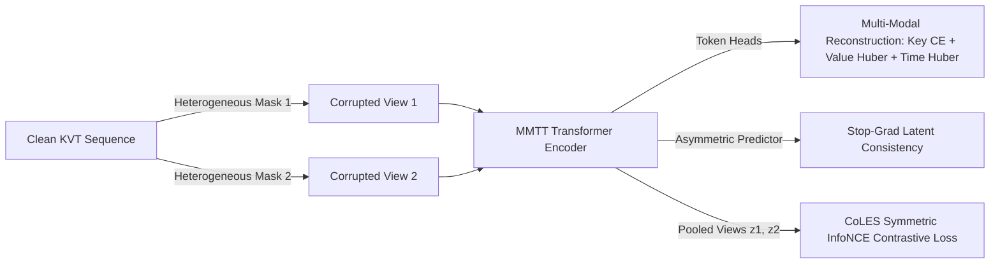

# 3. Collapse-Free Self-Supervised Pre-Training (LimiX, PRAGMA & CoLES)

In [`src/training/objectives.py`](../src/training/objectives.py) and [`src/training/lightning_module.py`](../src/training/lightning_module.py), the LDM implements a hybrid self-supervised learning (SSL) engine designed specifically to prevent **representation collapse** while capturing both local feature correlations and global user trajectory semantics.

---

## Why Naive Latent Masking Collapses

A common pitfall in tabular self-supervised learning is minimizing the Mean Squared Error between an online encoder's masked output $f_\theta(\tilde{x})$ and its unmasked output $\text{sg}(f_\theta(x))$ using identical network weights without input-space feature reconstruction or contrastive repulsion. In that regime, the network can minimize loss trivially by mapping all inputs toward a low-variance constant subspace.

To guarantee rich, high-rank representations, `LDMPreTrainingModule` combines three complementary mechanisms:

---

## 1. Heterogeneous Mask Schedule (`LimiX`)

Unlike natural language, financial transaction sequences exhibit strong local persistence (e.g., recurring merchant visits or split payments). Purely uniform random token masking (BERT-style) allows the model to interpolate trivially from immediate neighbors.

Following **LimiX** (`arXiv:2509.03505`), `ContextConditionalMaskedLoss.heterogeneous_mask_schedule` combines:
* **Cell Masking:** Independent random event corruption at base probability $p_{\text{mask}}$.
* **Contiguous Block Masking:** Temporal window expansion masking consecutive events so the model must infer multi-step spending trajectories rather than copying adjacent tokens.
* **Probabilistic Neighbor Expansion:** Stochastic bidirectional span widening across 30% of sequences, while guaranteeing at least one masked and one visible event per sequence.

---

## 2. Multi-Modal Feature & Asymmetric Latent Reconstruction (`PRAGMA` & `LimiX`)

At every non-padded masked position $i \in \mathcal{M}$, `LargeDataModel.predict_masked_modalities` projects the contextual token representation $\mathbf{h}_i \in \mathbb{R}^d$ through three modality-specific reconstruction heads plus an asymmetric latent predictor:

$$\mathcal{L}_{\text{multimodal}} = \mathcal{L}_{\text{CE}}(\hat{\mathbf{k}}_i, k_i) + \mathcal{L}_{\text{Huber}}(\hat{v}_i, v_i) + 0.25 \,\mathcal{L}_{\text{Huber}}(\hat{t}_i, \log(1 + \Delta t_i))$$

Because the encoder must simultaneously recover the discrete merchant category $k_i$, the standardized transaction amount $v_i$, and the log-time delta $\log(1 + \Delta t_i)$, constant-vector collapse is mathematically impossible.

---

## 3. Contrastive Event Sequence Learning (`CoLES`)

To ensure that the **sequence-level pooled representation** (`get_pooled_embedding`) is directly discriminative for downstream user-level classification, we integrate **CoLES** (*Contrastive Learning for Event Sequences*, Babaev et al., *SIGMOD* 2022, `arXiv:2002.08232`) via `ContrastiveEventSequenceLoss`:

1. Two independently masked views of each user's sequence in the mini-batch are encoded and pooled into $\mathbf{z}^{(1)}, \mathbf{z}^{(2)} \in \mathbb{R}^{B \times d}$.
2. Both views are $\ell_2$-normalized onto the unit hypersphere: $\tilde{\mathbf{z}}_u = \mathbf{z}_u / \|\mathbf{z}_u\|_2$.
3. Symmetric temperature-scaled InfoNCE loss pulls positive views of the same user together while pushing apart all $B - 1$ other users in the batch:
   $$\mathcal{L}_{\text{CoLES}} = -\frac{1}{2B} \sum_{u=1}^B \left[ \log \frac{\exp(\tilde{\mathbf{z}}_u^{(1)} \cdot \tilde{\mathbf{z}}_u^{(2)} / \tau)}{\sum_{v=1}^B \exp(\tilde{\mathbf{z}}_u^{(1)} \cdot \tilde{\mathbf{z}}_v^{(2)} / \tau)} + \log \frac{\exp(\tilde{\mathbf{z}}_u^{(2)} \cdot \tilde{\mathbf{z}}_u^{(1)} / \tau)}{\sum_{v=1}^B \exp(\tilde{\mathbf{z}}_u^{(2)} \cdot \tilde{\mathbf{z}}_v^{(1)} / \tau)} \right]$$

---

## Autoregressive Alternative: Next Token Prediction (`NextTokenPredictionLoss`)

For generative trajectory simulation (analogous to *TransactionGPT* and *TabGPT*), `NextTokenPredictionLoss` in [`src/training/objectives.py`](../src/training/objectives.py) provides causal next-event prediction (`is_causal=True`), jointly optimizing categorical Cross-Entropy with label smoothing and continuous MSE over shifted sequences $t_{1:S-1} \rightarrow t_{2:S}$.

---

**Next Step:** Read [04_finetuning_dcnv2.md](04_finetuning_dcnv2.md) to learn how pre-trained sequence embeddings are fused with static credit bureau features via DCNv2.
